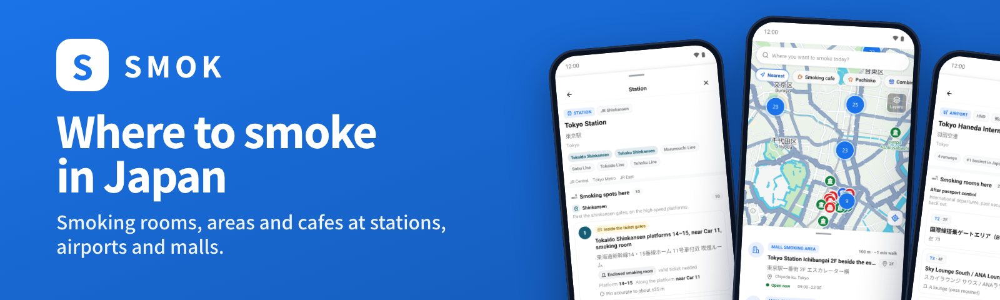

  

# Smok

**A map of the places in Japan where smoking is allowed.** Smoking rooms and open smoking areas at stations, airports and shopping malls, municipal smoking spots, and cafes: find the nearest one instead of guessing.

  
  
  

## What it does

- **Station, airport and mall rooms**: which floor, which side of security, how precise the pin is, opening hours.
- **Municipal smoking areas** that the city itself lists, with the page the information came from.
- **Search by place, station or category**, and a *Nearest* button for when you are standing in the street.
- **Street-smoking ban zones** drawn on the map for the wards and cities where they apply.
- **13 languages**: 日本語, English, 한국어, 繁體中文, ไทย, Tiếng Việt, Bahasa Indonesia, Español, Italiano, Deutsch, Français, Русский, Português.
- **Free**, no ads, no in-app purchases; the map works without an account.

## Where to get it

| | |
|---|---|
| **Google Play** | [to.smok.app](https://play.google.com/store/apps/details?id=to.smok.app) |
| **Android APK** | [smoktomap/smok-android → Releases](https://github.com/smoktomap/smok-android/releases) (signed with the Smok developer key, so not installable over a Google Play copy) |
| **Website** | [smok.to](https://smok.to) (also in 日本語: [smok.to/jp](https://smok.to/jp/)) |

## Our rule

Information is published only when an official source (the operator's own page or map, or the municipality's own list) confirms it. A place that is not confirmed stays off the map, and an empty list means *we have not checked*, not *there is nowhere to smoke*.

Smok exists so that smoke stays in the places made for it. Please follow local rules and signs, and keep Japan clean.

## Contact

[contact@smok.to](mailto:contact@smok.to)
